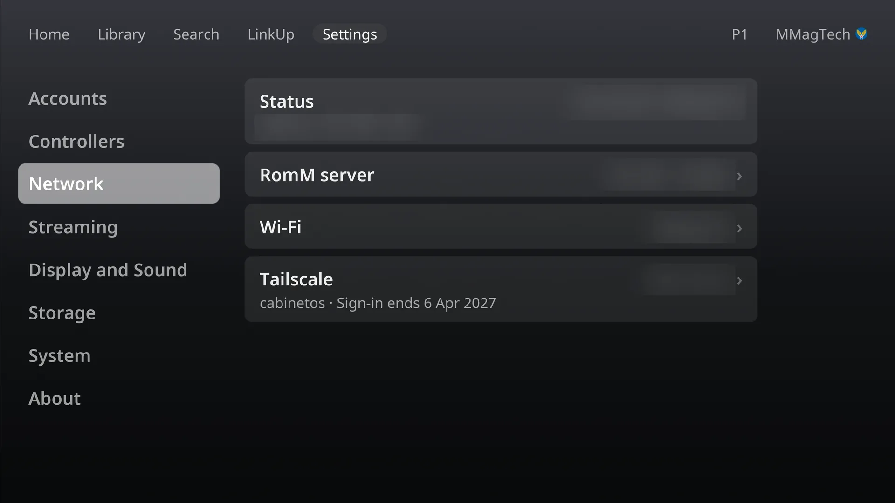

# Wi-Fi and network

Settings, **Network** shows how the console is connected, its address, your
RomM server, Wi-Fi and Tailscale.

- **Ethernet always wins.** With a cable plugged in, the console uses it, and
  Wi-Fi stays set up as a fallback.
- **Wi-Fi** appears when the PC has a Wi-Fi radio.

## Join or change a Wi-Fi network

Settings, Network, **Wi-Fi** (behind the PIN if one is set). If Wi-Fi is off,
pressing the row turns it on. The list shows the networks in range:

| Network | Pressing it offers |
|---|---|
| The one you are on | **Change password**, **Forget** |
| One you have joined before | **Join**, **Change password**, **Forget** |
| Any other | Joins it, asking for the password first if it has one |

Passwords are typed on the [on-screen keyboard](navigation.md#the-on-screen-keyboard)
or a USB keyboard.

## Not supported

- **Hidden networks.** Make the network visible to join it.
- **802.1X** networks (a user name and a password, common in offices and
  schools). They are left out of this list; [first run](first-run.md) shows
  them as *not supported*.

## The RomM server row

See [Your RomM server](romm.md#changing-or-leaving-the-server).

## Tailscale

[Tailscale](https://tailscale.com) lets your devices reach the console, and
the console reach your RomM server, from anywhere, without opening your
router. It is off to start with, and nothing of it runs until you turn it on.

1. Settings, Network, **Tailscale** (the PIN, if one is set).
2. Scan the QR code with a phone signed in to Tailscale: *Use the Tailscale
   account your phone is signed in to.* Approve it there.
3. The row shows the console's Tailscale address, and under it its name and
   the date its sign-in ends. **Sign in again** appears near the end.

Pressing the row again offers **Disconnect** and **Log out** (each asks for
the PIN). Disconnect keeps the sign-in, so **Connect** brings it straight
back. While a device is streaming with [Remote Play](remote-play.md), the row
is greyed.

Tailscale stays on until you turn it off, whatever Remote Play is doing. Use
it for [Remote Play away from home](remote-play.md#away-from-home-tailscale),
to reach RomM away from home (below), or both.

### Reaching RomM away from home

The console has one RomM address. To take it away from home, make that
address RomM's Tailscale address:

1. Set the console up at home, with RomM's home address, as usual.
2. Install Tailscale on the computer RomM runs on, signed in to the same
   Tailscale account. That computer gets an address starting with `100.`:
   use that address, not its Tailscale name.
3. On the console, sign in to Tailscale (above).
4. Settings, Network, **RomM server**, **Change address**, and type RomM's
   `100.` address with its port. It is the same server, so your games,
   saves and accounts stay.

From then on the console reaches RomM through Tailscale at home and away.
Leave Tailscale on: turned off, or signed out, the console cannot reach
RomM. So that the sign-in never ends, open Tailscale's admin page in a
browser, **Machines**, the console's menu, **Disable key expiry**. If it does
end, sign in again here. If the console is held on the start-up screen
waiting for the server, press **A** there, at home, and change the address
back to RomM's home address first.
